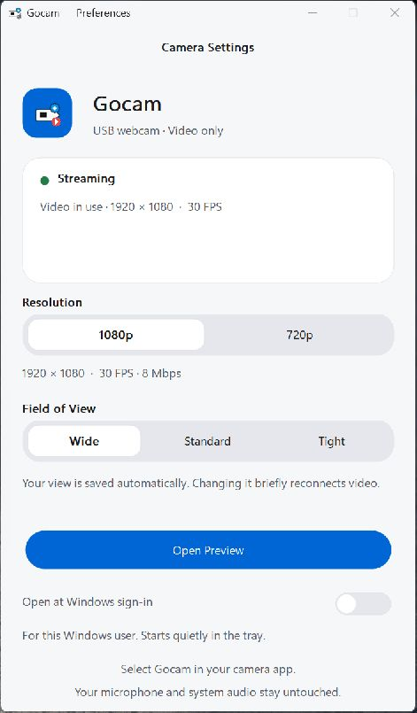
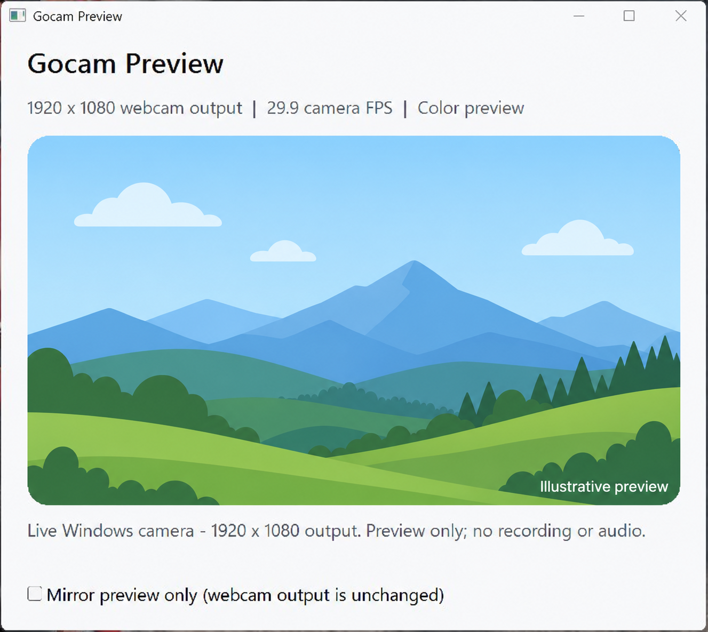

# Gocam

### A GoPro webcam utility

Gocam started with a simple frustration: a great camera, but too much webcam delay.

It’s an unofficial Windows alternative to GoPro Webcam, built to make the experience faster and easier.

## What’s better?

- **Less delay.** Development tests showed roughly 170 ms, compared with around 400 ms in our original test of the official utility.
- **Higher video bitrate.** 8 Mbps instead of the 6 Mbps observed in our stock setup—more room for video detail.
- **Simple controls.** Choose 1080p or 720p, and switch between Wide, Standard, and Tight views.
- **Only active when needed.** The camera starts when you use it and returns to USB mode when you’re done.
- **Stays out of your way.** Runs in the system tray, with an optional start-with-Windows toggle.

Your microphone and other audio stay untouched. No firmware changes needed.

## A look inside

Choose your resolution, adjust your view, and get back to your call.

*The preview picture is an illustration, not a camera-quality sample.*

## Getting started

Connect your GoPro and run **First-Time Setup.cmd**. Then open **Gocam.exe** and select **Gocam** in your camera app.

Requires Windows 11 x64 and a compatible GoPro. Supports up to 1080p at 30 FPS. Tested with Discord.

## A few things to know

Gocam is unofficial and isn’t affiliated with GoPro. For personal, noncommercial use only. Third-party licenses are included.

Uses FFmpeg under the LGPL. [License and build information](licenses/ffmpeg/README.md) · [Corresponding FFmpeg source](licenses/ffmpeg/ffmpeg-7.1.5.tar.xz?raw=true).

The app is unsigned, so Windows may show a warning. Setup requires administrator approval to register the camera and add its camera-specific firewall rule.
